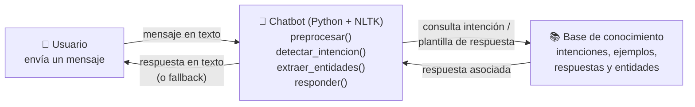
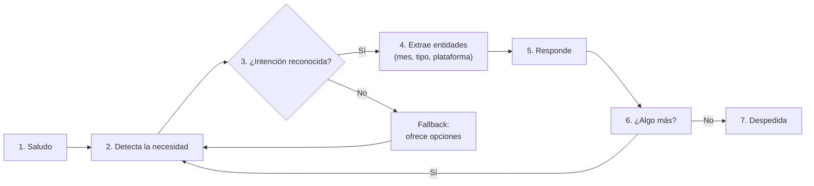

# AVANCE DE PROYECTO 1
## Asistente virtual de Servicios Escolares

**Curso:** Desarrollo de Aplicaciones de Inteligencia Artificial
**Estudiante:** José Eduardo Patena Ovalle
**Matrícula:** T07298385
**Profesor:** Mackenson Polché
**Fecha:** 25 de octubre de 2026

> Plantilla de trabajo basada en las instrucciones y la rúbrica del curso. Ver detalle
> completo en [avance-proyecto-1.md](../avance-proyecto-1.md).
> Formato general: ver [formato-apa.md](../../formato-apa.md).

---

## 1. Portada

- Nombre del estudiante: José Eduardo Patena Ovalle
- Matrícula: T07298385
- Nombre del curso: Desarrollo de Aplicaciones de Inteligencia Artificial
- Profesor: Mackenson Polché
- Nombre del proyecto: Avance de Proyecto 1 — Asistente virtual de Servicios Escolares
- Fecha: 25 de octubre de 2026

---

## 2. Introducción

Las áreas de Servicios Escolares de cualquier universidad reciben, todos los días, un
volumen alto de preguntas que se repiten casi sin cambios: horarios de atención, fechas
y forma de pago de la colegiatura, cómo tramitar una constancia o qué hacer cuando no se
puede entrar a una plataforma institucional (Canvas, correo, Blackboard). Atender estas
consultas de forma manual consume tiempo del personal administrativo y genera tiempos de
espera largos para el estudiante, especialmente en temporada de pagos o de inicio de
semestre.

Este avance presenta la primera versión de un **asistente virtual basado en reglas**,
construido en Python con NLTK, que responde automáticamente las consultas más frecuentes
y canaliza a una persona los casos que no reconoce. El objetivo de este documento es
mostrar el problema que se busca resolver, la arquitectura conceptual del asistente, el
diseño de sus intenciones conversacionales, el código fuente, la evidencia de su
ejecución y un primer análisis de resultados y limitaciones.

## 3. Problema seleccionado

| Elemento | Descripción |
| --- | --- |
| **Problema** | Las consultas repetitivas de los estudiantes sobre horarios, pagos de colegiatura, constancias y soporte de plataformas saturan los canales de atención de Servicios Escolares, generando tiempos de espera largos y una carga operativa alta para el personal administrativo. |
| **Objetivo general** | Diseñar la arquitectura conceptual e implementar un chatbot basado en reglas que resuelva de forma automática las consultas frecuentes de los estudiantes y canalice a una persona los casos que no pueda resolver. |
| **Usuarios objetivo** | Estudiantes de licenciatura y posgrado que necesitan resolver dudas administrativas comunes fuera del horario de atención o sin esperar turno. |
| **Alcance** | Horarios de atención, pago de colegiatura (fecha límite y medios de pago), solicitud de constancias (estudios, no adeudo, kardex) y soporte básico de plataformas (Canvas, correo institucional, Blackboard). **No incluye** trámites con datos personales sensibles, pagos en línea reales ni emisión de documentos oficiales: esas acciones se canalizan a una persona o al sistema correspondiente. |
| **Beneficios esperados** | Reducir el tiempo de espera de los estudiantes, ofrecer atención disponible las 24 horas para las preguntas más comunes, disminuir la carga operativa de Servicios Escolares y dejar que el personal se enfoque en los casos complejos. |

**Justificación del uso de IA:** se trata de un dominio con **reglas claras y
relativamente estables** (horarios, fechas de pago, requisitos de trámites) y un volumen
alto de preguntas que se repiten con pocas variantes. De acuerdo con la metodología vista
en clase ("¿Este problema necesita IA?", [clase-1.md](../clase-1.md)), cuando hay reglas
claras y estables conviene empezar con un enfoque simbólico (reglas) antes que con un
modelo de aprendizaje automático: es más barato de construir, totalmente trazable y
suficiente para este primer alcance. La complejidad del lenguaje natural (sinónimos,
errores de ortografía, frases ambiguas) sí justifica apoyarse en un pipeline de NLP
(normalización, tokenización, eliminación de *stopwords* y reducción a raíz), en vez de
una simple búsqueda de palabras clave.

## 4. Objetivo

Diseñar la arquitectura conceptual de un asistente inteligente e implementar un chatbot
funcional basado en reglas para atender consultas de estudiantes sobre horarios, pagos de
colegiatura, constancias y soporte de plataformas, con al menos diez conversaciones de
prueba documentadas.

## 5. Arquitectura propuesta

El asistente sigue la arquitectura modular vista en clase (usuario → chatbot → base de
conocimiento), con cuatro componentes y el intercambio de información entre ellos:



| Componente | Función | Qué recibe | Qué entrega |
| --- | --- | --- | --- |
| **Usuario** | Envía su consulta y recibe la respuesta. | — | Mensaje en lenguaje natural. |
| **Chatbot (Python + NLTK)** | Limpia el texto, detecta la intención, extrae entidades (mes, tipo de trámite, plataforma) y arma la respuesta. | Mensaje del usuario. | Intención + entidades + respuesta final. |
| **Base de conocimiento** | Diccionario de intenciones: ejemplos de frases, respuestas y entidades asociadas. | Nombre de la intención detectada. | Plantilla de respuesta a completar con las entidades. |
| **Flujo conversacional** | Define el orden de la conversación (saludo → necesidad → intención → datos → respuesta → confirmación → cierre) y el manejo de *fallback*. | Historial del turno actual. | Siguiente paso de la conversación. |

**Flujo conversacional general:**



## 6. Diseño conversacional

Se definieron **seis intenciones** más el **fallback**, todas vinculadas con el problema,
los usuarios y el alcance definidos en la sección 3. Para cada intención se muestra la
secuencia **entrada del usuario → identificación de la intención → respuesta del
chatbot**:

| Intención | Frases de ejemplo (≥ 4) | Entidad | Secuencia: entrada → intención → respuesta |
| --- | --- | --- | --- |
| `saludo` | "hola" · "buenos días" · "buenas tardes" · "qué tal" · "hola buenas" | — | "Hola, buenas tardes" → `saludo` → "¡Hola! Soy el asistente virtual de Servicios Escolares. Puedo ayudarte con horarios, pago de colegiatura, constancias y soporte de plataformas." |
| `consultar_horario` | "cuál es el horario de atención" · "a qué hora abren" · "cuándo atienden" · "horario de servicios escolares" · "a qué hora cierran" | — | "¿Cuál es el horario de atención?" → `consultar_horario` → "Atendemos de lunes a viernes de 9:00 a 18:00 horas." |
| `pagar_colegiatura` | "cómo pago mi colegiatura" · "quiero pagar la colegiatura" · "fecha límite de pago" · "dónde pago la colegiatura" · "cuánto cuesta la colegiatura" | `mes` | "Quiero pagar mi colegiatura de noviembre" → `pagar_colegiatura` (mes = noviembre) → "Puedes pagar tu colegiatura de noviembre en el portal de pagos con tarjeta o referencia bancaria; la fecha límite es el día 5 de cada mes." |
| `solicitar_constancia` | "necesito una constancia de estudios" · "cómo pido una constancia" · "quiero mi carta de no adeudo" · "necesito el kardex" · "cómo saco una constancia" | `tipo` | "¿Cómo saco mi carta de no adeudo?" → `solicitar_constancia` (tipo = no adeudo) → "Puedes solicitar tu constancia de no adeudo desde el portal del alumno, en la sección de trámites; se entrega en un plazo de 2 días hábiles." |
| `soporte_plataforma` | "no puedo entrar a canvas" · "olvidé mi contraseña" · "mi correo institucional no funciona" · "blackboard no carga" · "no me deja iniciar sesión" | `plataforma` | "No puedo entrar a Canvas" → `soporte_plataforma` (plataforma = canvas) → "Levanté un reporte de soporte para canvas. Un asesor de TI te contactará en menos de 24 horas." |
| `despedida` | "gracias" · "hasta luego" · "adiós" · "eso es todo" · "nos vemos" | — | "Gracias, hasta luego" → `despedida` → "¡Gracias por escribir! Que tengas un excelente día." |
| `fallback` | (cualquier mensaje que no supere el umbral de coincidencias) | — | "Quiero pizza" → `fallback` → "No estoy seguro de haber entendido. Puedo ayudarte con horarios, pagos, constancias o soporte de plataformas. ¿Sobre cuál quieres saber?" |

Reglas de diseño aplicadas: 6 intenciones + fallback (dentro del rango de 5 a 8 que
recomienda la clase), siempre incluye saludo, despedida y fallback, las frases de
ejemplo son variaciones reales de cómo pregunta un estudiante (no inventadas de forma
artificial), y cada intención está directamente ligada al alcance definido en la sección 3.

## 7. Código fuente

El chatbot se implementó en Python 3.10+ con NLTK, siguiendo el patrón de
preprocesamiento (normalizar → tokenizar → quitar *stopwords* → reducir a raíz) y
detección de intención por coincidencia de raíces visto en clase. El archivo completo
está en [`chatbot.py`](./chatbot.py); a continuación, las partes clave:

```python
import re
import unicodedata

import nltk
from nltk.corpus import stopwords
from nltk.stem import SnowballStemmer
from nltk.tokenize import word_tokenize

nltk.download("punkt", quiet=True)
nltk.download("punkt_tab", quiet=True)
nltk.download("stopwords", quiet=True)

stemmer = SnowballStemmer("spanish")


def normalizar(texto: str) -> str:
    """Minusculas, sin acentos y sin signos de puntuacion."""
    texto = texto.lower()
    texto = unicodedata.normalize("NFD", texto)
    texto = "".join(c for c in texto if unicodedata.category(c) != "Mn")
    return re.sub(r"[^a-z0-9\s]", " ", texto)


STOP = {normalizar(p).strip() for p in stopwords.words("spanish")}

INTENCIONES = {
    "saludo": {
        "ejemplos": ["hola", "buenos dias", "buenas tardes", "que tal", "hola buenas"],
        "respuesta": ("¡Hola! Soy el asistente virtual de Servicios Escolares. Puedo "
                      "ayudarte con horarios, pago de colegiatura, constancias y "
                      "soporte de plataformas."),
    },
    "consultar_horario": {
        "ejemplos": ["cual es el horario de atencion", "a que hora abren",
                     "cuando atienden", "horario de servicios escolares",
                     "a que hora cierran"],
        "respuesta": "Atendemos de lunes a viernes de 9:00 a 18:00 horas.",
    },
    "pagar_colegiatura": {
        "ejemplos": ["como pago mi colegiatura", "quiero pagar la colegiatura",
                     "fecha limite de pago", "donde pago la colegiatura",
                     "cuanto cuesta la colegiatura"],
        "respuesta": ("Puedes pagar tu colegiatura{mes_txt} en el portal de pagos con "
                      "tarjeta o referencia bancaria; la fecha límite es el día 5 de "
                      "cada mes."),
    },
    "solicitar_constancia": {
        "ejemplos": ["necesito una constancia de estudios", "como pido una constancia",
                     "quiero mi carta de no adeudo", "necesito el kardex",
                     "como saco una constancia"],
        "respuesta": ("Puedes solicitar tu constancia{tipo_txt} desde el portal del "
                      "alumno, en la sección de trámites; se entrega en un plazo de "
                      "2 días hábiles."),
    },
    "soporte_plataforma": {
        "ejemplos": ["no puedo entrar a canvas", "olvide mi contrasena",
                     "mi correo institucional no funciona", "blackboard no carga",
                     "no me deja iniciar sesion"],
        "respuesta": ("Levanté un reporte de soporte{plataforma_txt}. Un asesor de TI "
                      "te contactará en menos de 24 horas."),
    },
    "despedida": {
        "ejemplos": ["gracias", "hasta luego", "adios", "eso es todo", "nos vemos"],
        "respuesta": "¡Gracias por escribir! Que tengas un excelente día.",
    },
}

MESES = ["enero", "febrero", "marzo", "abril", "mayo", "junio", "julio",
         "agosto", "septiembre", "octubre", "noviembre", "diciembre"]

TIPOS_CONSTANCIA = {
    "estudios": ["estudios", "inscripcion"],
    "no adeudo": ["no adeudo", "noadeudo", "adeudo"],
    "kardex": ["kardex", "historial academico"],
}

PLATAFORMAS = {
    "canvas": ["canvas"],
    "correo institucional": ["correo", "outlook"],
    "blackboard": ["blackboard", "collaborate"],
}


def preprocesar(texto: str):
    """Normaliza, tokeniza y reduce a raiz, quitando palabras vacias."""
    tokens = word_tokenize(normalizar(texto), language="spanish")
    return [stemmer.stem(t) for t in tokens if t not in STOP]


# Verbos genericos ("quiero", "necesito"...) aparecen en casi todas las
# intenciones y, si no se excluyen, generan falsos positivos con mensajes
# fuera de alcance como "quiero pizza". Se excluyen solo para DETECTAR la
# intencion (no para extraer entidades ni para el resto del preprocesamiento).
GENERICAS = {stemmer.stem(v) for v in ("quiero", "quisiera", "necesito", "podria", "quiere")}


def tokens_para_intencion(texto: str):
    return [t for t in preprocesar(texto) if t not in GENERICAS]


VOCAB = {
    intencion: {raiz for ejemplo in datos["ejemplos"] for raiz in tokens_para_intencion(ejemplo)}
    for intencion, datos in INTENCIONES.items()
}


def detectar_intencion(mensaje: str, umbral: int = 1) -> str:
    """Compara las raices del mensaje contra el vocabulario de cada intencion."""
    tokens = set(tokens_para_intencion(mensaje))
    puntajes = {intencion: len(tokens & vocab) for intencion, vocab in VOCAB.items()}
    mejor = max(puntajes, key=puntajes.get)
    return mejor if puntajes[mejor] >= umbral else "fallback"


def extraer_entidades(mensaje: str) -> dict:
    """Busca mes, tipo de constancia y plataforma mediante diccionarios y regex."""
    texto = normalizar(mensaje)
    entidades = {}

    for mes in MESES:
        if re.search(rf"\b{mes}\b", texto):
            entidades["mes"] = mes

    for tipo, palabras in TIPOS_CONSTANCIA.items():
        if any(re.search(rf"\b{normalizar(p)}\b", texto) for p in palabras):
            entidades["tipo"] = tipo

    for plataforma, palabras in PLATAFORMAS.items():
        if any(re.search(rf"\b{normalizar(p)}\b", texto) for p in palabras):
            entidades["plataforma"] = plataforma

    return entidades


def responder(mensaje: str) -> str:
    """Detecta la intencion, extrae entidades y arma la respuesta final."""
    intencion = detectar_intencion(mensaje)
    if intencion == "fallback":
        return ("No estoy seguro de haber entendido. Puedo ayudarte con horarios, "
                 "pagos, constancias o soporte de plataformas. ¿Sobre cuál quieres saber?")

    entidades = extraer_entidades(mensaje)
    plantilla = INTENCIONES[intencion]["respuesta"]
    return plantilla.format(
        mes_txt=f" de {entidades['mes']}" if "mes" in entidades else "",
        tipo_txt=f" de {entidades['tipo']}" if "tipo" in entidades else "",
        plataforma_txt=f" para {entidades['plataforma']}" if "plataforma" in entidades else "",
    )
```

El archivo [`chatbot.py`](./chatbot.py) incluye además la función `chat()` para
conversar de forma interactiva (pensada para usarse en Google Colab), y
[`evaluar.py`](./evaluar.py) ejecuta las pruebas funcionales descritas a continuación.

**Código fuente en GitHub:** _(pendiente: subir esta carpeta a un repositorio de GitHub y
pegar aquí el enlace antes de entregar, tal como pide la instrucción 5)._

## 8. Evidencias de ejecución

Se probó el chatbot con **12 conversaciones distintas** (más de las 10 mínimas
requeridas), ejecutando [`evaluar.py`](./evaluar.py) sobre el código real de
[`chatbot.py`](./chatbot.py). La transcripción completa fue la siguiente:

```text
Bot: ¡Hola! Soy el asistente virtual de Servicios Escolares. Puedo ayudarte con
     horarios, pago de colegiatura, constancias y soporte de plataformas.

Tú:  Hola, buenas tardes
Bot: ¡Hola! Soy el asistente virtual de Servicios Escolares. Puedo ayudarte con
     horarios, pago de colegiatura, constancias y soporte de plataformas.
     [esperado=saludo | detectado=saludo | correcto]

Tú:  ¿Cuál es el horario de atención?
Bot: Atendemos de lunes a viernes de 9:00 a 18:00 horas.
     [esperado=consultar_horario | detectado=consultar_horario | correcto]

Tú:  ¿A qué hora cierran los viernes?
Bot: Atendemos de lunes a viernes de 9:00 a 18:00 horas.
     [esperado=consultar_horario | detectado=consultar_horario | correcto]

Tú:  Quiero pagar mi colegiatura de noviembre
Bot: Puedes pagar tu colegiatura de noviembre en el portal de pagos con tarjeta o
     referencia bancaria; la fecha límite es el día 5 de cada mes.
     [esperado=pagar_colegiatura | detectado=pagar_colegiatura | correcto]

Tú:  ¿Cuál es la fecha límite de pago?
Bot: Puedes pagar tu colegiatura en el portal de pagos con tarjeta o referencia
     bancaria; la fecha límite es el día 5 de cada mes.
     [esperado=pagar_colegiatura | detectado=pagar_colegiatura | correcto]

Tú:  Necesito una constancia de estudios
Bot: Puedes solicitar tu constancia de estudios desde el portal del alumno, en la
     sección de trámites; se entrega en un plazo de 2 días hábiles.
     [esperado=solicitar_constancia | detectado=solicitar_constancia | correcto]

Tú:  ¿Cómo saco mi carta de no adeudo?
Bot: Puedes solicitar tu constancia de no adeudo desde el portal del alumno, en la
     sección de trámites; se entrega en un plazo de 2 días hábiles.
     [esperado=solicitar_constancia | detectado=solicitar_constancia | correcto]

Tú:  No puedo entrar a Canvas
Bot: Levanté un reporte de soporte para canvas. Un asesor de TI te contactará en
     menos de 24 horas.
     [esperado=soporte_plataforma | detectado=soporte_plataforma | correcto]

Tú:  Olvidé mi contraseña del correo institucional
Bot: Levanté un reporte de soporte para correo institucional. Un asesor de TI te
     contactará en menos de 24 horas.
     [esperado=soporte_plataforma | detectado=soporte_plataforma | correcto]

Tú:  Gracias, hasta luego
Bot: ¡Gracias por escribir! Que tengas un excelente día.
     [esperado=despedida | detectado=despedida | correcto]

Tú:  Quiero pizza
Bot: No estoy seguro de haber entendido. Puedo ayudarte con horarios, pagos,
     constancias o soporte de plataformas. ¿Sobre cuál quieres saber?
     [esperado=fallback | detectado=fallback | correcto]

Tú:  xq no me deja entrar jaja
Bot: Levanté un reporte de soporte. Un asesor de TI te contactará en menos de
     24 horas.
     [esperado=fallback | detectado=soporte_plataforma | INCORRECTO]
```

Tabla resumen (también disponible en [`pruebas/casos.csv`](./pruebas/casos.csv)):

| # | Mensaje | Intención esperada | Intención detectada | ¿Correcto? |
| --- | --- | --- | --- | --- |
| 1 | "Hola, buenas tardes" | saludo | saludo | Sí |
| 2 | "¿Cuál es el horario de atención?" | consultar_horario | consultar_horario | Sí |
| 3 | "¿A qué hora cierran los viernes?" | consultar_horario | consultar_horario | Sí |
| 4 | "Quiero pagar mi colegiatura de noviembre" | pagar_colegiatura | pagar_colegiatura | Sí |
| 5 | "¿Cuál es la fecha límite de pago?" | pagar_colegiatura | pagar_colegiatura | Sí |
| 6 | "Necesito una constancia de estudios" | solicitar_constancia | solicitar_constancia | Sí |
| 7 | "¿Cómo saco mi carta de no adeudo?" | solicitar_constancia | solicitar_constancia | Sí |
| 8 | "No puedo entrar a Canvas" | soporte_plataforma | soporte_plataforma | Sí |
| 9 | "Olvidé mi contraseña del correo institucional" | soporte_plataforma | soporte_plataforma | Sí |
| 10 | "Gracias, hasta luego" | despedida | despedida | Sí |
| 11 | "Quiero pizza" (fuera de alcance) | fallback | fallback | Sí |
| 12 | "xq no me deja entrar jaja" (informal, sin plataforma) | fallback | soporte_plataforma | No |

## 9. Resultados

- **Tasa de comprensión:** 11 de 12 conversaciones (92 %) obtuvieron la intención
  esperada.
- **Tasa de fallback:** 1 de 12 (8 %); el chatbot reconoció correctamente cuando un
  mensaje estaba fuera de su alcance ("Quiero pizza").
- **Iteración realizada durante las pruebas:** en una primera versión, el umbral de
  coincidencias era de 1 raíz y mensajes como "Quiero pizza" se clasificaban como
  `pagar_colegiatura` (falso positivo), porque la palabra "quiero" aparecía en varias
  intenciones y bastaba para "ganar" por coincidencia. Se identificó esta limitación,
  se excluyeron del vocabulario de detección los verbos genéricos ("quiero",
  "necesito", "podría"...) y la precisión subió de 10/12 (83 %) a 11/12 (92 %) sin
  afectar ninguna de las intenciones correctas.
- **Limitación identificada:** el caso 12 ("xq no me deja entrar jaja") se clasificó
  como `soporte_plataforma` en lugar de `fallback`, porque comparte raíces ("no",
  "deja", "entrar") con el ejemplo "no me deja iniciar sesión". Es un caso límite
  razonable (el usuario sí podría estar reportando que no puede entrar a algo), pero
  el chatbot responde sin pedir primero a qué plataforma se refiere.
- **Mejora propuesta para el siguiente avance:** cuando se detecte la intención
  `soporte_plataforma` pero no se haya extraído ninguna entidad `plataforma`, el bot
  debería preguntar "¿A qué plataforma te refieres: Canvas, correo o Blackboard?" en
  lugar de responder de forma genérica; esto convierte la entidad en un *slot*
  obligatorio antes de ejecutar la acción, tal como se vio en el Tema 4 de la clase 2.

## 10. Conclusiones

Esta primera versión del asistente cumple el alcance definido: reconoce las seis
intenciones principales con una tasa de comprensión del 92 % sobre los casos de prueba y
siempre ofrece una salida clara (respuesta útil o *fallback*) en vez de dejar al usuario
sin opciones. El proceso de prueba y corrección (de 83 % a 92 % de aciertos) mostró en la
práctica por qué el curso insiste en **probar con casos reales y analizar los errores**,
no solo con las frases "fáciles": la mejora más efectiva no fue agregar más reglas, sino
quitar palabras demasiado genéricas del vocabulario de decisión. El siguiente avance
debería incorporar *slots* obligatorios para las entidades críticas (como la plataforma
en soporte técnico) y, más adelante, evaluar si conviene complementar las reglas con un
clasificador de aprendizaje automático para el lenguaje más informal que no cubren los
ejemplos actuales.

## 11. Nota metodológica (uso de herramientas de IA)

- **Herramientas utilizadas:** GitHub Copilot (asistente conversacional de IA integrado
  en VS Code).
- **Para qué se utilizaron:** como apoyo para organizar la estructura del documento
  según el formato del curso, redactar un primer borrador de las secciones y adaptar el
  patrón de chatbot de reglas visto en clase (normalización, tokenización, detección de
  intención por raíces) al problema específico de Servicios Escolares.
- **Partes elaboradas directamente por el estudiante:** la elección del problema real
  (consultas de Servicios Escolares), la definición de usuarios, alcance y beneficios,
  las intenciones y entidades específicas, la ejecución real de las pruebas, el
  análisis de por qué fallaba el caso de "Quiero pizza" y la decisión de cómo
  corregirlo (excluir verbos genéricos en vez de solo subir el umbral) fueron
  revisados y decididos por mí antes de considerarlos parte final del documento.

## 12. Referencias (formato APA)

Jurafsky, D., & Martin, J. H. (2025). *Speech and language processing* (3.ª ed.)
[Borrador en línea]. Stanford University. https://web.stanford.edu/~jurafsky/slp3/

NLTK Project. (2024). *Natural Language Toolkit documentation*.
https://www.nltk.org/

Universidad TecMilenio. (2026). *Clase 2 — Fundamentos de chatbots y chatbots basados en
reglas* [Material de curso]. Desarrollo de Aplicaciones de Inteligencia Artificial.

Universidad TecMilenio. (2026). *Avance de Proyecto 1 — Instrucciones y rúbrica*
[Material de curso]. Desarrollo de Aplicaciones de Inteligencia Artificial.
