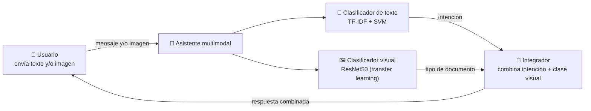

# AVANCE DE PROYECTO 2
## Asistente virtual de Servicios Escolares — versión multimodal

**Curso:** Desarrollo de Aplicaciones de Inteligencia Artificial
**Estudiante:** José Eduardo Patena Ovalle
**Matrícula:** T07298385
**Profesor:** Mackenson Polché
**Fecha:** Semana 5

> Plantilla de trabajo basada en las instrucciones y la rúbrica del curso. Ver detalle
> completo en [avance-proyecto-2.md](../avance-proyecto-2.md).
> Formato general: ver [formato-apa.md](../../formato-apa.md).
> Este avance recupera y amplía el proyecto del
> [Avance de Proyecto 1](../avance-proyecto-1/AVANCE%20DE%20PROYECTO%201.md).

---

## 1. Portada

- Nombre del estudiante: José Eduardo Patena Ovalle
- Matrícula: T07298385
- Nombre del curso: Desarrollo de Aplicaciones de Inteligencia Artificial
- Profesor: Mackenson Polché
- Nombre del proyecto: Avance de Proyecto 2 — Asistente virtual de Servicios Escolares
  (versión multimodal: texto + imagen)
- Fecha: Semana 5

---

## 2. Introducción

El Avance de Proyecto 1 dejó un chatbot basado en reglas (Python + NLTK) que resuelve
cuatro tipos de consulta de Servicios Escolares: horarios, pago de colegiatura,
constancias y soporte de plataformas. Ese chatbot detectaba la intención comparando
raíces de palabras contra un vocabulario fijo por intención — funcionaba, pero no
"aprendía" de ejemplos ni podía interpretar nada que no fuera texto.

Este avance corrige y amplía esa solución en dos direcciones, siguiendo los Temas 5 al
10 del curso:

1. **Procesamiento de lenguaje natural con Machine Learning:** se construyó un
   conjunto de datos etiquetado por intención, se aplicó un pipeline completo de
   preprocesamiento (tokenización, normalización, eliminación de *stopwords* y
   *stemming*), se representó el texto con **TF-IDF** y se entrenaron y compararon dos
   clasificadores (**Naive Bayes** y **SVM**) para reemplazar la detección por
   coincidencia de raíces del Avance 1.
2. **Visión por computadora:** se agregó un segundo canal de entrada —imágenes— para
   que el asistente también pueda recibir lo que un estudiante normalmente adjunta en
   una conversación real de Servicios Escolares: una constancia, un comprobante de
   pago, su credencial o una captura de un error de plataforma. Se entrenó una **CNN
   con transferencia de aprendizaje (ResNet50)** para clasificar esas cuatro clases.
3. **Integración multimodal:** el asistente ahora puede recibir texto, imagen, o
   ambos a la vez, y combina los dos resultados en una sola respuesta (por ejemplo,
   confirmando cuando lo que el estudiante escribió coincide con lo que se detectó en
   la imagen que adjuntó).

Todo el código está organizado en tres carpetas dentro de
[`avance-proyecto-2/`](.): [`texto/`](./texto) (NLP + clasificación de intenciones),
[`imagenes/`](./imagenes) (dataset sintético + CNN) e
[`integracion/`](./integracion) (el asistente multimodal final).

## 3. Revisión del problema, objetivo, usuarios, alcance y arquitectura (instrucción 1)

Se recuperan del Avance de Proyecto 1 sin cambios, porque siguen siendo válidos para
esta ampliación:

| Elemento | Descripción |
| --- | --- |
| **Problema** | Las consultas repetitivas de los estudiantes sobre horarios, pagos de colegiatura, constancias y soporte de plataformas saturan los canales de atención de Servicios Escolares. |
| **Objetivo general** | Ampliar el chatbot de reglas del Avance 1 con componentes de NLP entrenado y clasificación de imágenes, para que el asistente entienda mejor el lenguaje natural de los estudiantes y pueda interpretar documentos/capturas que adjunten. |
| **Usuarios objetivo** | Estudiantes de licenciatura y posgrado que necesitan resolver dudas administrativas comunes fuera del horario de atención. |
| **Alcance** | Mismo alcance del Avance 1 (horarios, pago de colegiatura, constancias, soporte de plataformas), ahora con la capacidad adicional de recibir y clasificar una imagen adjunta relacionada con esos mismos cuatro temas. |
| **Beneficios esperados** | Mejor generalización ante frases no vistas (gracias al clasificador de ML) y menos pasos para el estudiante cuando adjunta evidencia visual (comprobantes, capturas de error). |

**Ajuste de coherencia:** en el Avance 1 el chatbot generaba además *entidades* (mes,
tipo de constancia, plataforma) mediante reglas y expresiones regulares. Para esta
ampliación, la detección de la intención se delega al clasificador de ML (ver sección
5), que sustituye la coincidencia de raíces como método de clasificación; la lógica de
respuesta por intención se conserva (ver [`asistente_multimodal.py`](./integracion/asistente_multimodal.py)).

**Arquitectura actualizada:**



## 4. Conjunto de datos textual (instrucción 2)

Se construyó un conjunto de **105 frases etiquetadas** con las mismas 7 categorías del
Avance 1 (6 intenciones + `fallback`), ampliando de ~5 a 15 ejemplos por intención para
dar variedad suficiente a un clasificador entrenado (a diferencia del Avance 1, que solo
necesitaba frases para comparar raíces). Ver
[`texto/dataset_intenciones.py`](./texto/dataset_intenciones.py).

| Intención | Ejemplos |
| --- | --- |
| `saludo` | 15 |
| `consultar_horario` | 15 |
| `pagar_colegiatura` | 15 |
| `solicitar_constancia` | 15 |
| `soporte_plataforma` | 15 |
| `despedida` | 15 |
| `fallback` | 15 |

Se separó en entrenamiento (78 frases, 75 %) y prueba (27 frases, 25 %) de forma
estratificada por intención.

## 5. Preprocesamiento de texto (instrucción 3)

El pipeline, implementado en [`texto/preprocesamiento.py`](./texto/preprocesamiento.py),
reutiliza el criterio de normalización del Avance 1 y aplica las 4 técnicas requeridas:

```python
def preprocesar(texto: str) -> list[str]:
    """Pipeline completo: tokenización -> normalización -> stopwords -> stemming."""
    tokens = tokenizar(texto)          # normaliza (minúsculas, sin acentos/puntuación)
                                        # y tokeniza con NLTK word_tokenize
    tokens = quitar_stopwords(tokens)  # elimina stopwords en español (NLTK)
    return lematizar(tokens)           # SnowballStemmer("spanish")
```

Ejemplo real de salida:

```text
Original:      ¿Cuál es el horario de atención de Servicios Escolares?
Tokenizado:    ['cual', 'es', 'el', 'horario', 'de', 'atencion', 'de', 'servicios', 'escolares']
Sin stopwords: ['horario', 'atencion', 'servicios', 'escolares']
Preprocesado:  ['horari', 'atencion', 'servici', 'escolar']
```

## 6. Representación y clasificación de intenciones (instrucciones 4 y 5)

Se representó el texto con **TF-IDF** (`TfidfVectorizer` de scikit-learn, usando el
pipeline anterior como tokenizador), generando un vocabulario de **117 términos** sobre
las 78 frases de entrenamiento.

Se entrenaron y compararon dos clasificadores sobre esa misma representación
(ver [`texto/clasificador_texto.py`](./texto/clasificador_texto.py)):

| Modelo | Accuracy (prueba) | Observación |
| --- | --- | --- |
| **Naive Bayes** (`MultinomialNB`) | **81.48 %** | Confunde `fallback` con otras intenciones (recall 0.0 en esa clase) y sobregeneraliza `consultar_horario` (precision 0.50). |
| **SVM** (`LinearSVC`) | **92.59 %** | Mejor en casi todas las clases; solo pierde un poco de recall en `soporte_plataforma` (0.75) y en `fallback` (0.75). |

Reporte de clasificación del modelo seleccionado (**SVM**, el que se guarda para la
integración):

```text
                      precision    recall  f1-score   support

              saludo       1.00      1.00      1.00         4
   consultar_horario       1.00      1.00      1.00         3
   pagar_colegiatura       1.00      1.00      1.00         4
solicitar_constancia       1.00      1.00      1.00         4
  soporte_plataforma       1.00      0.75      0.86         4
           despedida       0.80      1.00      0.89         4
            fallback       0.75      0.75      0.75         4

            accuracy                           0.93        27
           macro avg       0.94      0.93      0.93        27
        weighted avg       0.93      0.93      0.93        27
```

Matrices de confusión: [`matriz_confusion_naive_bayes.png`](./texto/resultados/matriz_confusion_naive_bayes.png)
y [`matriz_confusion_svm.png`](./texto/resultados/matriz_confusion_svm.png).

**Análisis:** con un dataset pequeño (105 frases), SVM generaliza mejor que Naive Bayes
porque busca el hiperplano de máximo margen entre clases en lugar de asumir
independencia entre palabras; Naive Bayes es más sensible a que ciertas raíces
("atencion", "horari") aparezcan en más de una intención. El modelo final usado por el
asistente multimodal es **SVM + TF-IDF**.

## 7. Conjunto de imágenes (instrucción 6)

El Avance 1 no incluía ningún componente visual, así que este dataset se construyó
desde cero, ligado al mismo dominio del chatbot: documentos/capturas que un estudiante
adjuntaría al conversar con el asistente. Para evitar cualquier problema de derechos de
autor (no se descargó ninguna imagen de internet), el dataset se **genera de forma
sintética y reproducible** con PIL
(ver [`imagenes/generar_dataset.py`](./imagenes/generar_dataset.py)):

| Clase | Qué representa | Imágenes (train / val / test) |
| --- | --- | --- |
| `constancia` | Constancia de estudios / no adeudo / kardex | 90 / 20 / 20 |
| `comprobante_pago` | Recibo de pago de colegiatura | 90 / 20 / 20 |
| `credencial` | Credencial de estudiante | 90 / 20 / 20 |
| `captura_error` | Captura de un error de Canvas/Blackboard/correo | 90 / 20 / 20 |

Total: **520 imágenes** (224×224 px), con variaciones aleatorias de texto (nombre,
matrícula, folio, monto, mensaje de error), color de fondo, ruido gaussiano leve y
desenfoque ocasional para simular la variabilidad de una foto o captura real.

## 8. Arquitectura y desarrollo del clasificador visual (instrucción 7)

Se usó **ResNet50 preentrenada en ImageNet** (`torchvision.models.resnet50`,
pesos `IMAGENET1K_V2`) con **transferencia de aprendizaje por extracción de
características**: se congelan todos los pesos del backbone convolucional y solo se
entrena una nueva capa totalmente conectada (`fc`) para las 4 clases del proyecto
(ver [`imagenes/clasificador_imagenes.py`](./imagenes/clasificador_imagenes.py)):

```python
def construir_modelo(n_clases: int) -> nn.Module:
    """ResNet50 preentrenada en ImageNet con el backbone congelado."""
    modelo = resnet50(weights=ResNet50_Weights.IMAGENET1K_V2)
    for parametro in modelo.parameters():
        parametro.requires_grad = False
    modelo.fc = nn.Linear(modelo.fc.in_features, n_clases)
    return modelo.to(DISPOSITIVO)
```

Entrenamiento: 8 épocas, optimizador Adam (`lr=1e-3`) solo sobre `modelo.fc`,
`CrossEntropyLoss`, con *data augmentation* en entrenamiento (flip horizontal, rotación
±8°, variación de brillo/contraste). Curva de pérdida y accuracy de validación por
época: [`curvas_entrenamiento.png`](./imagenes/resultados/curvas_entrenamiento.png).

```text
Época 1/8 - pérdida: 0.8943 - val_accuracy: 98.75%
Época 2/8 - pérdida: 0.3561 - val_accuracy: 100.00%
Época 3/8 - pérdida: 0.1751 - val_accuracy: 100.00%
Época 4/8 - pérdida: 0.1396 - val_accuracy: 100.00%
Época 5/8 - pérdida: 0.1005 - val_accuracy: 100.00%
Época 6/8 - pérdida: 0.0795 - val_accuracy: 100.00%
Época 7/8 - pérdida: 0.0610 - val_accuracy: 100.00%
Época 8/8 - pérdida: 0.0614 - val_accuracy: 100.00%
```

## 9. Evaluación del modelo visual (instrucción 8)

Resultados sobre el conjunto de **prueba** (80 imágenes, 20 por clase):

| Métrica | Valor |
| --- | --- |
| Accuracy | **100.00 %** |
| Precision (macro) | **100.00 %** |
| Recall (macro) | **100.00 %** |
| F1-score (macro) | **100.00 %** |

Matriz de confusión: [`matriz_confusion_imagenes.png`](./imagenes/resultados/matriz_confusion_imagenes.png)
(diagonal perfecta, sin confusiones entre clases).

**Análisis:** el 100 % de exactitud es consistente con que las 4 clases son
**visualmente muy distintas entre sí** por diseño (layout, paleta de color y
composición), no con que la tarea sea trivialmente fácil en general — es una
limitación conocida del dataset sintético (ver sección 11).

## 10. Integración multimodal (instrucción 9)

[`integracion/asistente_multimodal.py`](./integracion/asistente_multimodal.py) carga
el clasificador de texto (TF-IDF + SVM) y el clasificador visual (ResNet50) ya
entrenados, y expone `AsistenteMultimodal.procesar(mensaje, ruta_imagen)`, que:

1. Si hay texto, predice la intención y arma la respuesta correspondiente.
2. Si hay imagen, predice la clase visual e interpreta qué significa para el trámite
   (p. ej. `comprobante_pago` → "quedó registrado el pago").
3. Si hay **ambos**, compara la intención del texto contra la intención asociada a la
   clase visual detectada y lo dice explícitamente (coincide / no coincide), en vez de
   solo concatenar dos respuestas independientes.

Ejemplos reales de ejecución (ver transcripción completa en
[`integracion/resultados_integracion.json`](./integracion/resultados_integracion.json)):

```text
Tú: Hola, buenas tardes (sin imagen)
Bot: ¡Hola! Soy el asistente virtual de Servicios Escolares. ¿En qué te ayudo?

Tú: (sin texto) [imagen: comprobante_pago]
Bot: Veo que adjuntaste un comprobante de pago. Quedó registrado el pago de tu
     colegiatura; no necesitas hacer nada más.

Tú: Ya pagué mi colegiatura, aquí está mi comprobante [imagen: comprobante_pago]
Bot: Puedes pagar tu colegiatura en el portal de pagos; la fecha límite es el día 5
     de cada mes. Veo que adjuntaste un comprobante de pago. Quedó registrado el
     pago de tu colegiatura; no necesitas hacer nada más. (Tu mensaje y la imagen
     que adjuntaste coinciden, así que ya puedo continuar con el trámite sin
     pedirte más datos.)

Tú: Necesito mi constancia de estudios [imagen: credencial]
Bot: Puedes solicitar tu constancia desde el portal del alumno; se entrega en 2
     días hábiles. Veo que adjuntaste tu credencial de estudiante. Tu identidad
     quedó validada para continuar el trámite.
```

El último ejemplo muestra un caso de texto e imagen **no relacionados** (el estudiante
pide una constancia pero adjunta su credencial): el sistema responde a cada canal por
separado sin forzar una coincidencia falsa.

## 11. Resultados, limitaciones y conclusiones (instrucción 10)

**Resultados generales:**

- El clasificador de texto mejoró la capacidad de generalización frente al Avance 1:
  donde antes se necesitaba que una palabra exacta (o su raíz) apareciera en el
  vocabulario de ejemplos, ahora SVM + TF-IDF alcanza **92.59 % de accuracy** sobre
  frases de prueba no usadas en entrenamiento.
- El clasificador visual alcanzó **100 % de accuracy, precision, recall y F1-score**
  sobre su conjunto de prueba.
- La integración combina ambos canales y detecta explícitamente cuando el texto y la
  imagen adjunta se refieren al mismo trámite.

**Limitaciones:**

1. El dataset textual (105 frases) es pequeño; `fallback` sigue siendo la clase con
   menor F1-score (0.75) porque es, por definición, la más heterogénea (cualquier
   frase fuera de alcance).
2. El dataset de imágenes es **sintético**, no son fotos reales de documentos o
   capturas de pantalla reales de Canvas/Blackboard. Las 4 clases son visualmente muy
   distintas entre sí a propósito, por lo que el 100 % de exactitud probablemente no se
   mantendría con documentos reales (con más ruido, ángulos de cámara, iluminación
   variable o plataformas con interfaces parecidas entre sí).
3. La integración actual decide "coincide / no coincide" solo cuando la clase visual
   tiene una intención relacionada predefinida (`comprobante_pago`→`pagar_colegiatura`,
   `captura_error`→`soporte_plataforma`, `constancia`→`solicitar_constancia`); no
   generaliza a combinaciones no previstas.

**Conclusiones orientadas a la versión final:**

- Para la versión final conviene **ampliar el dataset textual** con frases reales de
  estudiantes (por ejemplo, del historial de reportes de soporte generado en el
  Avance 1) y probar balanceo de clases para mejorar `fallback`.
- Conviene **sustituir el dataset sintético de imágenes por fotos/capturas reales**
  (con consentimiento y anonimizando datos personales) antes de integrar el sistema en
  un entorno real, ya que la facilidad actual del 100 % de accuracy es optimista.
- La integración multimodal puede extenderse de una regla fija (`intención ↔ clase
  visual`) a un **modelo conjunto** que combine ambos vectores de características
  (texto + imagen) en una sola predicción, en vez de combinarlos después de clasificar
  por separado.

## 12. Referencias

- Documentación oficial de scikit-learn: *TfidfVectorizer*, *MultinomialNB*,
  *LinearSVC*. https://scikit-learn.org/stable/
- Documentación oficial de NLTK: *tokenize*, *corpus.stopwords*, *stem.snowball*.
  https://www.nltk.org/
- Documentación oficial de PyTorch/torchvision: *models.resnet50*,
  *transforms*. https://pytorch.org/vision/stable/models.html
- He, K., Zhang, X., Ren, S., & Sun, J. (2016). *Deep Residual Learning for Image
  Recognition*. CVPR.
- Contenidos de clase: [clase-3.md](../clase-3.md) (Temas 5 y 6),
  [clase-4.md](../clase-4.md) (Temas 7 y 8) y [clase-5.md](../clase-5.md) (Temas 9 y 10).
- Avance de Proyecto 1 del mismo estudiante:
  [AVANCE DE PROYECTO 1.md](../avance-proyecto-1/AVANCE%20DE%20PROYECTO%201.md).
